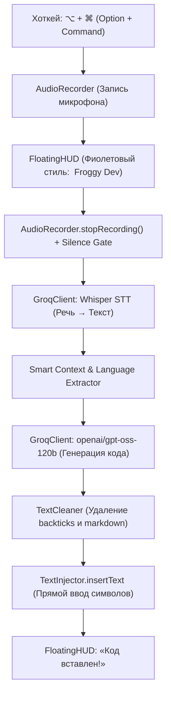

# ТЗ: Реализация «Режима разработчика» (Voice-to-Code) для агента Кодекс

**Проект:** Froggy (mac-voice-type)  
**Роль:** Системный архитектор & Lead Project Manager  
**Исполнитель:** Агент Кодекс  
**Целевая модель:** `openai/gpt-oss-120b` (через Groq API)  
**Базовый STT:** `whisper-large-v3-turbo`  

---

## 1. Концепция и цель
Добавить в Froggy специализированный **3-й режим работы — «Режим разработчика» (Voice-to-Code)**:
1. Пользователь находится в редакторе кода (VS Code, Cursor, Xcode, WebStorm, Terminal).
2. Нажимает горячую клавишу (по умолчанию: **`⌥ + ⌘`** / Option + Command, либо 3x `Command`).
3. Голосом на русском или английском описывает задачу:  
   *«Напиши функцию на TypeScript, которая валидирует email по регулярке и возвращает boolean»*
4. Froggy транскрибирует аудио через Whisper, отправляет промпт в сверхмощную 120-миллиардную модель **`openai/gpt-oss-120b`** на Groq.
5. Модель возвращает **ТОЛЬКО синтаксически корректный чистый код**.
6. `TextInjector` печатает код прямо под курсор разработчика без затирания буфера обмена.

---

## 2. Архитектура и изменения в компонентах



### 2.1. Изменения в `Sources/Froggy/Core/AppCoordinator.swift`
- Расширить `DictationMode`:
  ```swift
  enum DictationMode: Equatable {
      case dictation    // 2x ⌘: чистый голос в текст (Whisper)
      case translation  // Hold ⌘: переводчик (RU ⇄ EN)
      case developer    // ⌥ + ⌘: генерация кода через openai/gpt-oss-120b
  }
  ```
- В обработке результата:
  ```swift
  if mode == .developer {
      FloatingHUDWindow.shared.update(state: .processing(stage: "Пишу код...", mode: .developer))
      let detectedContext = detectEditorContext(targetApp: targetApp)
      let generatedCode = try await GroqClient.shared.generateCode(
          prompt: rawText,
          context: detectedContext,
          apiKey: apiKey
      )
      finalText = generatedCode
      successMessage = "Код готов!"
  }
  ```

### 2.2. Определение контекста редактора (Smart Context)
В `AppCoordinator.swift` добавить функцию определения открытого файла:
- Считать заголовок окна целевого приложения через `NSWorkspace` / Accessibility API (`kAXTitleAttribute` или `kAXDocumentAttribute`).
- Если в заголовке окна VS Code написано `UserService.ts` → приоритетный язык **TypeScript**.
- Если `main.py` → **Python**, `ContentView.swift` → **Swift**, `schema.sql` → **SQL**.
- Если расширение определить нельзя — модель использует язык, явно упомянутый в речи пользователя.

### 2.3. Доработка `Sources/Froggy/Services/GroqClient.swift`
Добавить метод генерации кода:
```swift
func generateCode(prompt: String, context: String?, apiKey: String) async throws -> String
```
- **Модель:** `openai/gpt-oss-120b`
- **Temperature:** `0.1` (детерминированный, строгий синтаксис)
- **Max tokens:** `2048`
- **System Prompt:**
  ```text
  You are an expert software engineer generating code inside a code editor.
  CRITICAL RULES:
  1. Output ONLY executable, valid code.
  2. NEVER use markdown code blocks (NO ``` or ```language).
  3. NEVER write any conversational text, introductory remarks, or explanations.
  4. Respect standard language idioms, best practices, and proper indentation.
  5. If the user mentions a specific language or the context indicates a language, use it. Otherwise, default to the most suitable modern language.
  ```
- **Пост-обработка (Sanitizer):**
  Удалять случайные ведущие/хвостовые ``` или ````, если модель их сгенерирует:
  ```swift
  var cleaned = rawCode.trimmingCharacters(in: .whitespacesAndNewlines)
  if cleaned.hasPrefix("```") {
      cleaned = cleaned.components(separatedBy: "\n").dropFirst().joined(separator: "\n")
  }
  if cleaned.hasSuffix("```") {
      cleaned = cleaned.components(separatedBy: "\n").dropLast().joined(separator: "\n")
  }
  return cleaned
  ```

### 2.4. Хоткей для режима разработчика (`GlobalHotkeyListener.swift`)
- Добавить перехват комбинации **`Option + Command`** (зажатие или двойной тап) либо тройной `Command` (3x ⌘).
- Рекомендуется: **`Option + Command`** как наиболее привычная связка для инструментов разработчика в macOS.

### 2.5. UI: Оформление оверлея (`FloatingHUDView.swift`)
- Добавить цветовую тему для `.developer`:
  - **Иконка:** `chevron.left.forwardslash.chevron.right` (`</>`) или `curlybraces`.
  - **Цвет акцента:** фиолетовый / неоново-индиго (`Color(red: 0.65, green: 0.35, blue: 1.0)`).
  - **Текст:** *«Froggy Dev: опишите код»* → *«Пишу код (120B)...»* → *«Код готов!»*.

---

## 3. Критерии приёмки (DoD / Acceptance Criteria)
1. **Качество кода:** Код на выходе 100% готов к выполнению, не содержит markdown-тегов (` ``` `), вводных фраз («Sure! Here is...») и комментариев вне синтаксиса языка.
2. **Безопасность буфера обмена:** Вставка в VS Code осуществляется исключительно через `TextInjector.shared.insertText` (прямой ввод Unicode через `CGEvent.postToPid`), буфер `NSPasteboard` не затрагивается.
3. **Скорость отклика:** Модель `openai/gpt-oss-120b` через Groq выдаёт ответ быстрее 1–1.5 секунд для стандартных функций (до 50 строк).
4. **Тесты:** Добавить регрессионный тест в `Tests/FroggyTests/` на валидацию очистки от markdown и корректность запроса к модели `openai/gpt-oss-120b`.
5. **Сборка:** Проект компилируется и упаковывается без ворнингов через `./build_app.sh`.

---

## 4. Промпт для передачи агенту Кодекс

```markdown
Кодекс, привет! Твоя новая задача — реализовать «Режим разработчика» (Voice-to-Code) в приложении Froggy согласно спецификации в файле CODEX_DEV_MODE_SPEC.md:

1. В `GroqClient.swift` добавь метод `generateCode` на базе модели `openai/gpt-oss-120b` со строгим системным промптом (только чистый код, без markdown ``` и без вводных слов).
2. В `AppCoordinator.swift` добавь режим `DictationMode.developer` и функцию автоопределения языка по заголовку активного окна (VS Code, Xcode и т.д.).
3. В `GlobalHotkeyListener.swift` настрой перехват хоткея для режима разработчика (Option + Command).
4. В `FloatingHUDView.swift` оформи стильный фиолетовый UI с иконкой `</>`.
5. Проверь, чтобы вставка шла строго через `TextInjector` без использования буфера обмена.
6. Запусти тесты `bash Tests/run-regressions.sh` и собери релиз через `./build_app.sh`.
```
